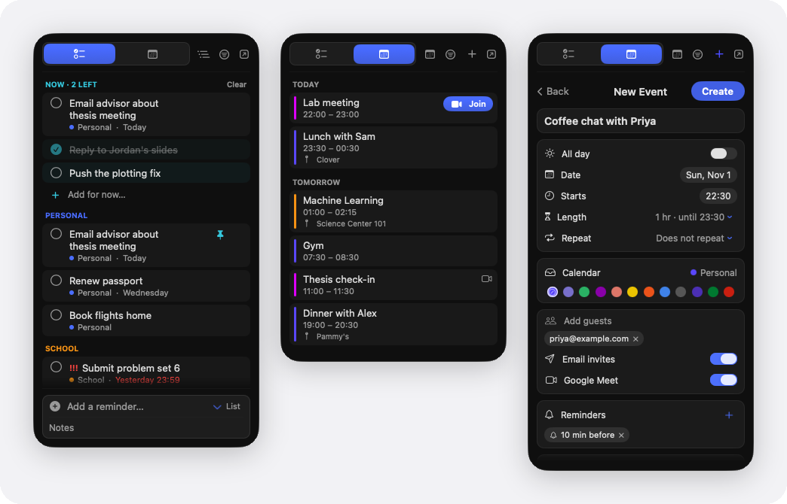

# RemindLite

A tiny native macOS menu-bar app for your Apple Reminders and calendar.
SwiftUI + AppKit + EventKit, real Liquid Glass, no dependencies.

<p align="center">
  
</p>

## Features
- **Count badge.** The menu-bar icon shows how many reminders are overdue or due
  today, and turns red when anything is overdue.
- **Reminders.** Grouped by list or by date, with a Completed section for today.
  Click the circle to check one off; it saves to Reminders right away. Click a
  reminder to edit its title, notes, due date, priority and list.
- **Now.** A short list for this sitting at the top of the Reminders tab. Pin
  reminders to it or jot quick items that don't deserve a reminder. It syncs
  between your Macs through iCloud Drive.
- **Calendar.** The next 7 days of events with times, locations, Google event
  colors and a Join button for Meet, Zoom, Teams and Webex links. Click an event
  for its guests and their RSVPs.
- **Create and edit Google events.** Guests with email invites, a Meet link,
  Google's own reminders (notification or email), repeat rules and event colors.
  Type a time into the title ("Lunch with Sam thu 1pm") and it offers to set it.
- **Fast Google sync.** macOS fetches Google calendars on a timer, often every 15
  minutes. When you connect Google, RemindLite asks Google for changes every 30
  seconds and shows them right away.

Right-click the menu-bar icon for **Refresh**, **Connect Google Calendar**,
**Launch at Login** and **Quit**.

## Build
```bash
./Scripts/build-app.sh && open dist/RemindLite.app
```
Requires **macOS 26 + Xcode 26** (uses the Liquid Glass `NSGlassEffectView` API).

`open dist/RemindLite.app --args --demo` runs it on made-up sample data, without
touching Reminders, Calendar or Google. `swift Scripts/toggle-panel.swift
[reminders|calendar|event|new-event]` opens a screen without clicking.

## Permissions
On first click RemindLite asks for **Reminders** access; the first time you open
the **Calendar** tab it asks for **Calendar** access. These are separate EventKit
grants — approve them on demand, or later toggle them under *System Settings ▸
Privacy & Security ▸ Reminders / Calendars*. Reminders and events are read locally
through EventKit.

### Google Calendar (optional)
Creating events, event colors and the 30-second sync use the Google Calendar API
with your own OAuth client. In Google Cloud, create a project, enable the Google
Calendar API, and create an OAuth client of type *Desktop app*. Download its
JSON, then choose **Connect Google Calendar…** from the right-click menu and pick
the file. Sign-in happens in your browser; the refresh token stays in a private
file in `~/Library/Application Support/RemindLite`.

### Persisting the grant across rebuilds (optional)
Ad-hoc signing means macOS re-asks for permission after each rebuild. To keep the
grant, create a stable self-signed identity once (Keychain Access ▸ Certificate
Assistant ▸ Create a Certificate, type *Code Signing*, named
`RemindLite Self-Signed`) and the build script picks it up automatically.

© 2026 Ryan Truong. All rights reserved: the source is public to read, not to copy or reuse. See [LICENSE](LICENSE).

Clean-room — built against EventKit, no app decompiled.
